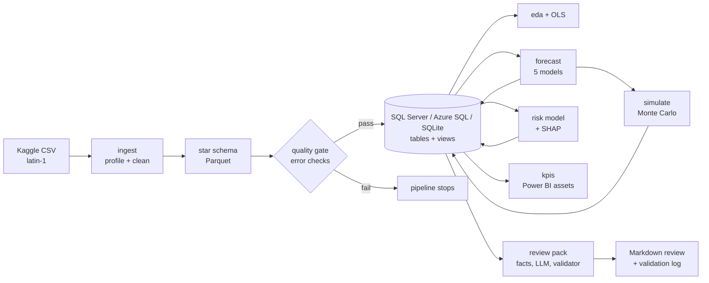

<!-- Generated from docs/README.template.md by `python -m sca results`. Edit the template, not this file. -->

# SupplyPulse: supply chain analytics and demand forecasting

An operations-analytics project on the DataCo retail supply chain dataset: a validated data pipeline, a weekly demand forecast, a late-delivery risk model, an inventory simulation, Power BI assets and a monthly review pack whose numbers are checked against the data before it is written. Business questions first, honest results throughout.

## Executive summary

The headline numbers below come from `reports/RESULTS.md`; each one links to the code that produced it.

- **Demand is steady and forecastable to about {{wape_f}} error.** {{forecast_champion_f}} predicts weekly units per category with a backtest WAPE of {{wape_f}}, {{wape_improvement_f}} better than a seasonal-naive baseline ({{wape_naive_f}}). A plain 8-week moving average is only {{ma_gap_f}} percentage points behind, so there is little structure beyond the level to exploit.
- **Lateness is a promise problem, not a regional one.** {{on_time_f}} of {{orders_f}} orders ship on time. First Class ships late {{late_first_class_f}} of the time and Standard Class {{late_standard_f}}. Shipping mode alone predicts lateness with ROC-AUC {{roc_auc_mode_only_f}}; the best model reaches {{roc_auc_f}}.
- **Textbook safety stock under-delivers.** Stock set by the standard formula for a 95% service target gives {{textbook_service_95_f}} simulated service once supplier lead times vary. Going from 90% to 98% simulated service cuts the chance of at least one stockout in a year from {{stockout_before_f}} to {{stockout_after_f}} for {{holding_change_f}} holding cost (under stated assumptions).
- **Margin is {{margin_f}} and discounts do not explain it.** Discount depth shows no measurable link to margin % ({{discount_coef_f}} pp per +1 pp of discount, p = {{discount_p_f}}). {{loss_items_share_f}} of items lose money, erasing {{loss_vs_gross_profit_f}} of gross profit, and 10 products account for {{loss_top10_products_f}} of those losses.
- **The pipeline is gated and tested.** {{rows_raw_f}} raw rows become {{rows_clean_f}} clean rows through {{dq_checks}} automated data-quality checks ({{dq_failing_errors_f}} error-severity failures), {{tests_f}} tests cover it, and the review pack cannot publish a number that is not in the data.

## Business questions and answers

| # | Question | Method | Answer |
|---|---|---|---|
| Q1 | How much demand per category over the next 8-12 weeks? | Time-series forecasting, rolling-origin backtests | 12-week forecast for {{n_categories}} categories plus total; champion {{forecast_champion_f}}, WAPE {{wape_f}} (total demand {{wape_total_f}}). `reports/forecast_results.md` |
| Q2 | Which orders will ship late, and why? | Order-level classification, SHAP | ROC-AUC {{roc_auc_f}}, PR-AUC {{pr_auc_f}} on the most recent 20% of orders; driven by shipping mode and scheduled days. `reports/risk_model_results.md` |
| Q3 | How much safety stock, and at what cost? | Monte Carlo simulation | Per-category recommendations; textbook stock delivers {{textbook_service_95_f}} against a 95% target. `reports/simulation_results.md` |
| Q4 | Where do we lose margin? | Profitability analysis and OLS | Losses sit in a few products, not in discounts or regions. `reports/eda_findings.md` |
| Q5 | Can the monthly review be drafted without made-up numbers? | Grounded LLM review pack | Yes: a validator rejects any number not in the facts, with a deterministic fallback. `reports/review_packs/` |

## Demo app

`frontend/` is a React + Vite + TypeScript app for walking someone through the project: the business scorecard, a late-order alert threshold you can drag, a forecast explorer, a safety-stock simulation read-out, and the review pack with every number clickable back to its fact. It has no backend. `python -m sca site` writes `frontend/src/data/data.json` from the outputs of a full run, so the app can only show numbers the pipeline produced; the number check from `grounding.py` is re-implemented in TypeScript and tested against the real packs.

```
python -m sca site
cd frontend
npm install
npm run dev      # http://localhost:5173
npm run build    # static files in frontend/dist
```

## Dashboard

Four report pages are specified for Power BI (`dashboard/`): an executive scorecard, demand forecast, delivery risk and margin pages, with {{dax_measures}} DAX measures, a colour-blind-safe theme and a build guide. **The `.pbix` itself has not been built**; the images below are Python-drawn versions of the same views, generated from the same data.


## Pipeline



## Methods and validation

- **Data quality as code.** {{dq_checks}} named checks with severities (primary keys, not-null, foreign keys, ranges, date logic, reconciliations, label consistency, duplicates). Any error-severity failure stops the pipeline.
- **Spec vs data.** Profiling contradicted the dataset description in three places and the code follows the data: `Sales` and `Order Item Total` differ by the discount (so both are kept), cancelled and suspected-fraud orders carry a late label of 0 (so they are flagged and excluded from delivery analysis), and two different categories are both named "Electronics" (disambiguated by department).
- **Forecast backtesting.** Expanding-window rolling origins ({{folds}} folds x {{horizon_weeks}} weeks), never a random split. WAPE is primary; MAPE is reported with an instability flag. The abnormal low-volume tail after {{cutoff}} (weekly volume down {{tail_drop_f}}) is excluded from training and testing. Every feature of the LightGBM model is computed from the past only, and a test proves it.
- **Leakage prevention.** The late-delivery model works at order level (items of one order share a label), uses a time-based split, and a unit test asserts that no post-shipping column (`delivery_status`, shipping days, ship date, order status, profit fields) can reach the feature matrix. An AUC above 0.95 would trigger a leakage investigation; the model's is {{roc_auc_f}}.
- **Simulation.** Periodic-review order-up-to policy, 10,000 paths x 52 weeks per stock level, bootstrapped backtest residuals, random lead times, common random numbers, validated against textbook results with known answers.
- **LLM grounding.** The model sees only `facts.json` (from fixed, versioned SQL queries). Every number must match a fact cited on the same line; unknown fact ids and uncited numbers are rejected; one retry with feedback; then a deterministic template that passes the same validator. Model names come from `.env`, never from the code.

## Limitations and assumptions

- **The data look synthetic.** Margin and late-delivery relationships are very uniform (discounts, region and category explain almost none of the item-level margin; R-squared {{discount_r2_f}}), and the late rule of Same Day orders flips at exactly noon. Treat findings as properties of this dataset, not of retail in general.
- **Inventory is simulated.** The dataset has no inventory. Supplier lead times, holding cost and unit cost are assumptions in `config.yaml`, listed in `reports/simulation_results.md`; change them and every number changes.
- **The regression is associational.** It does not show that changing discounts would change profit.
- **Order volume collapses after {{cutoff}}** for reasons the data cannot explain. The forecast assumes the earlier regime continues, and the late-delivery test period includes the low-volume months.
- **Small backtest.** {{folds}} folds x {{horizon_weeks}} weeks means about 40 test weeks per series; differences of a few WAPE points between models are within noise.
- **SARIMA uses Fourier terms** for yearly seasonality instead of a literal 52-week seasonal period, which cannot be estimated from about 2.5 years of weekly data.
- **Only one review pack is LLM-written.** `review_2018-01.md` was drafted by Groq; the first draft was rejected by the grounding validator (an unsupported 41%), and the second passed (see its `.validation.json`). Gemini could not be used: `gemini-2.5-flash` returned 404 for this key and `gemini-3.8-flash` returned 503 when tried. `review_2017-09.md` is the deterministic template because Groq failed validation twice. The generated text is still a draft for a human to read, not a finished report.
- **Power BI is not built.** DAX, theme, page specs, a build guide and reconciliation numbers are provided and tested against the real schema; the `.pbix` and screenshots are the next step.
- **SQL Server via `pyodbc`** needs ODBC Driver 18, which was not installed on the development machine. The T-SQL schema, views and fact queries were validated on SQL Server 2022 (Docker) through `sqlcmd` and match the SQLite results; the Python load path was exercised on SQLite.

## How to run

Requires Python 3.11. Windows-first (PowerShell), works on Linux and macOS.

```powershell
git clone https://github.com/swarnkarkuldeep/SupplyPulse.git
cd SupplyPulse
py -3.11 -m venv .venv
.\.venv\Scripts\Activate.ps1
pip install -r requirements.txt
pip install -e . --no-deps
```

**Data.** Download the Kaggle dataset "DataCo SMART SUPPLY CHAIN FOR BIG DATA ANALYSIS" and put `DataCoSupplyChainDataset.csv` and `DescriptionDataCoSupplyChain.csv` in `data/raw/` (optional: `scripts/download_data.py` uses the Kaggle CLI if you have a token). `data/raw/` and `data/processed/` are git-ignored; `data/sample/` is a committed 2.5K-row stratified sample used by tests and CI.

**SQLite only (no server, no API keys):**

```powershell
python -m sca all --no-llm            # everything on the full data, SQLite at data/processed/sca.db
python -m sca all --sample --no-llm   # the same on the committed sample
```

**SQL Server in Docker:**

```powershell
copy .env.example .env     # set DB_BACKEND=sqlserver, MSSQL_SA_PASSWORD and DB_PASSWORD to the same strong password
docker compose up -d       # SQL Server 2022 with a healthcheck and a named volume
python -m sca all --no-llm
```

Windows notes: `pyodbc` needs **ODBC Driver 18 for SQL Server** (Microsoft download). Local Docker uses a self-signed certificate, so the connection uses `TrustServerCertificate=yes` (set by default for `DB_BACKEND=sqlserver`). Azure SQL needs only `DB_BACKEND=azure`, the host and credentials in `.env`.

**Commands** (`python -m sca <command>`; add `--sample` to any of them):

| Command | What it does |
|---|---|
| `ingest` | Profile, clean and write the star schema |
| `quality` | Run the data-quality checks (fails on errors) |
| `load` | Load tables and views into the database |
| `eda` | EDA charts and the margin regression |
| `forecast` | Backtest five models, pick a champion, forecast 12 weeks |
| `risk` | Train and explain the late-delivery model |
| `simulate` | Inventory Monte Carlo simulation |
| `kpis` | Export Power BI data and draw the dashboard pages |
| `review-pack` | Generate the grounded monthly review (`--month YYYY-MM`, `--no-llm`) |
| `results` | Rebuild `reports/RESULTS.md` and this README from the outputs |
| `all` | Everything above in order |

Notebooks in `notebooks/` tell the story with functions from `src/`; `02_forecasting.ipynb` also runs on Google Colab. Model training runs locally in about a minute.

## Repo structure and tech stack

```
src/sca/        config, db, ingest, clean, quality, load, eda, profitability, forecasting, risk_model,
                simulation, kpis, review_pack, grounding, results, viz, cli
sql/            sqlserver/ schema, views, fact queries; sqlite/ schema
dashboard/      DAX measures, theme, page spec, build guide, reconciliation numbers
frontend/       React + Vite demo app (data.json is generated by `python -m sca site`)
notebooks/      01_eda, 02_forecasting, 03_delivery_risk, 04_simulation
reports/        data profile, cleaning log, quality report, findings, model results, review packs, RESULTS.md
tests/          {{tests_f}} tests (cleaning, quality gates on broken fixtures, leakage, backtests, simulation, grounding)
```

Python 3.11, pandas, SQLAlchemy 2, SQL Server 2022 / Azure SQL / SQLite, statsmodels, Prophet, scikit-learn, LightGBM, SHAP, matplotlib, Typer, pydantic-settings, google-genai and groq (optional), pytest and ruff, GitHub Actions CI. MIT licence.
