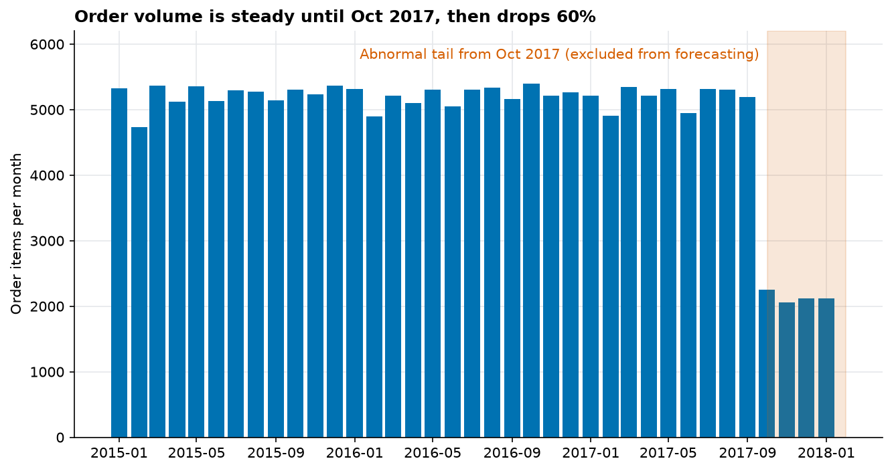
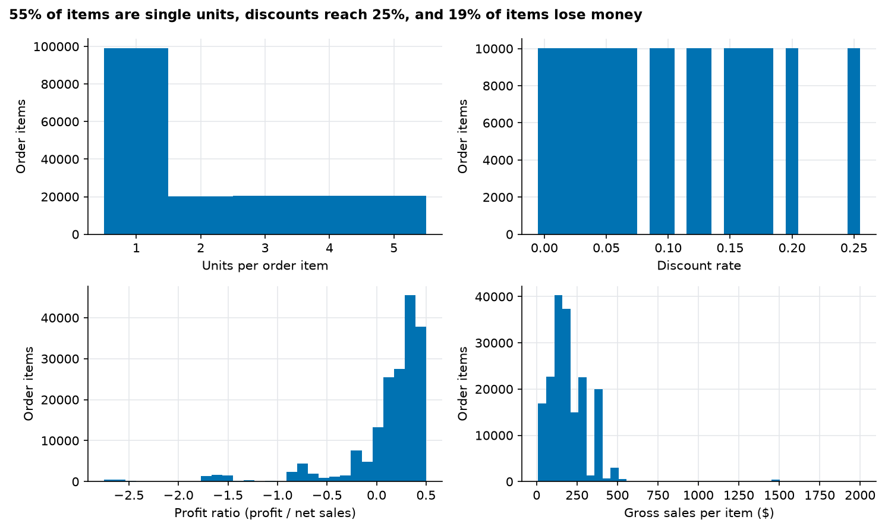

# Raw data profile

Generated by `python -m sca ingest`. Every number below was computed from the raw file.

## Shape and integrity

- **180,519 rows x 53 columns** (one row per order item)
- 65,752 distinct orders, 20,652 distinct customers
- Fully duplicated rows: **0**
- Order dates: 2015-01-01 to 2018-01-31
- Shipping dates: 2015-01-03 to 2018-02-06
- Encoding: UTF-8 fails at byte 1709; latin-1 decodes cleanly

## Monthly order volume

Weekly volume falls from a median of 1,193 order items (26 weeks before) to 480 from the week starting 2017-10-02, a 60% drop that never recovers (17 weeks). The break is abrupt and the tail is nearly constant, which is more consistent with a change in how the data was produced than with a change in demand (an inference; the data cannot prove it). Forecasting stops at **2017-10-01**.

## Columns: dtype, nulls, cardinality

| Column | dtype | Null rate | Distinct |
|---|---|---:|---:|
| Type | str | 0.0% | 4 |
| Days for shipping (real) | int64 | 0.0% | 7 |
| Days for shipment (scheduled) | int64 | 0.0% | 4 |
| Benefit per order | float64 | 0.0% | 21,998 |
| Sales per customer | float64 | 0.0% | 2,927 |
| Delivery Status | str | 0.0% | 4 |
| Late_delivery_risk | int64 | 0.0% | 2 |
| Category Id | int64 | 0.0% | 51 |
| Category Name | str | 0.0% | 50 |
| Customer City | str | 0.0% | 563 |
| Customer Country | str | 0.0% | 2 |
| Customer Email | str | 0.0% | 1 |
| Customer Fname | str | 0.0% | 782 |
| Customer Id | int64 | 0.0% | 20,652 |
| Customer Lname | str | 0.0% | 1,109 |
| Customer Password | str | 0.0% | 1 |
| Customer Segment | str | 0.0% | 3 |
| Customer State | str | 0.0% | 46 |
| Customer Street | str | 0.0% | 7,458 |
| Customer Zipcode | float64 | 0.0% | 995 |
| Department Id | int64 | 0.0% | 11 |
| Department Name | str | 0.0% | 11 |
| Latitude | float64 | 0.0% | 11,250 |
| Longitude | float64 | 0.0% | 4,487 |
| Market | str | 0.0% | 5 |
| Order City | str | 0.0% | 3,597 |
| Order Country | str | 0.0% | 164 |
| Order Customer Id | int64 | 0.0% | 20,652 |
| order date (DateOrders) | str | 0.0% | 65,752 |
| Order Id | int64 | 0.0% | 65,752 |
| Order Item Cardprod Id | int64 | 0.0% | 118 |
| Order Item Discount | float64 | 0.0% | 1,017 |
| Order Item Discount Rate | float64 | 0.0% | 18 |
| Order Item Id | int64 | 0.0% | 180,519 |
| Order Item Product Price | float64 | 0.0% | 75 |
| Order Item Profit Ratio | float64 | 0.0% | 162 |
| Order Item Quantity | int64 | 0.0% | 5 |
| Sales | float64 | 0.0% | 193 |
| Order Item Total | float64 | 0.0% | 2,927 |
| Order Profit Per Order | float64 | 0.0% | 21,998 |
| Order Region | str | 0.0% | 23 |
| Order State | str | 0.0% | 1,089 |
| Order Status | str | 0.0% | 9 |
| Order Zipcode | float64 | 86.2% | 609 |
| Product Card Id | int64 | 0.0% | 118 |
| Product Category Id | int64 | 0.0% | 51 |
| Product Description | float64 | 100.0% | 0 |
| Product Image | str | 0.0% | 118 |
| Product Name | str | 0.0% | 118 |
| Product Price | float64 | 0.0% | 75 |
| Product Status | int64 | 0.0% | 1 |
| shipping date (DateOrders) | str | 0.0% | 63,701 |
| Shipping Mode | str | 0.0% | 4 |

## Key numeric distributions

| Column | Mean | Std | Min | Median | Max |
|---|---:|---:|---:|---:|---:|
| Days for shipping (real) | 3.50 | 1.62 | 0.00 | 3.00 | 6.00 |
| Days for shipment (scheduled) | 2.93 | 1.37 | 0.00 | 4.00 | 4.00 |
| Benefit per order | 21.97 | 104.43 | -4,274.98 | 31.52 | 911.80 |
| Sales per customer | 183.11 | 120.04 | 7.49 | 163.99 | 1,939.99 |
| Late_delivery_risk | 0.55 | 0.50 | 0.00 | 1.00 | 1.00 |
| Category Id | 31.85 | 15.64 | 2.00 | 29.00 | 76.00 |
| Customer Id | 6,691.38 | 4,162.92 | 1.00 | 6,457.00 | 20,757.00 |
| Customer Zipcode | 35,921.13 | 37,542.46 | 603.00 | 19,380.00 | 99,205.00 |
| Department Id | 5.44 | 1.63 | 2.00 | 5.00 | 12.00 |
| Latitude | 29.72 | 9.81 | -33.94 | 33.14 | 48.78 |
| Longitude | -84.92 | 21.43 | -158.03 | -76.85 | 115.26 |
| Order Customer Id | 6,691.38 | 4,162.92 | 1.00 | 6,457.00 | 20,757.00 |
| Order Id | 36,221.89 | 21,045.38 | 1.00 | 36,140.00 | 77,204.00 |
| Order Item Cardprod Id | 692.51 | 336.45 | 19.00 | 627.00 | 1,363.00 |
| Order Item Discount | 20.66 | 21.80 | 0.00 | 14.00 | 500.00 |
| Order Item Discount Rate | 0.10 | 0.07 | 0.00 | 0.10 | 0.25 |
| Order Item Id | 90,260.00 | 52,111.49 | 1.00 | 90,260.00 | 180,519.00 |
| Order Item Product Price | 141.23 | 139.73 | 9.99 | 59.99 | 1,999.99 |
| Order Item Profit Ratio | 0.12 | 0.47 | -2.75 | 0.27 | 0.50 |
| Order Item Quantity | 2.13 | 1.45 | 1.00 | 1.00 | 5.00 |
| Sales | 203.77 | 132.27 | 9.99 | 199.92 | 1,999.99 |
| Order Item Total | 183.11 | 120.04 | 7.49 | 163.99 | 1,939.99 |
| Order Profit Per Order | 21.97 | 104.43 | -4,274.98 | 31.52 | 911.80 |
| Order Zipcode | 55,426.13 | 31,919.28 | 1,040.00 | 59,405.00 | 99,301.00 |
| Product Card Id | 692.51 | 336.45 | 19.00 | 627.00 | 1,363.00 |
| Product Category Id | 31.85 | 15.64 | 2.00 | 29.00 | 76.00 |
| Product Description | nan | nan | nan | nan | nan |
| Product Price | 141.23 | 139.73 | 9.99 | 59.99 | 1,999.99 |
| Product Status | 0.00 | 0.00 | 0.00 | 0.00 | 0.00 |
