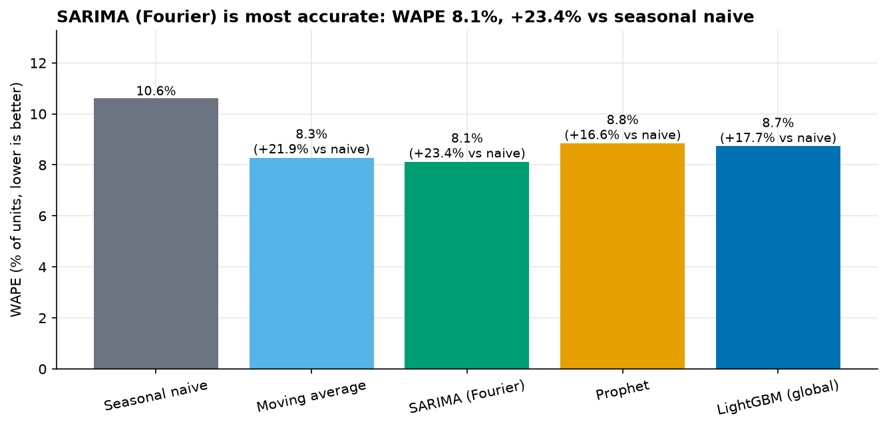
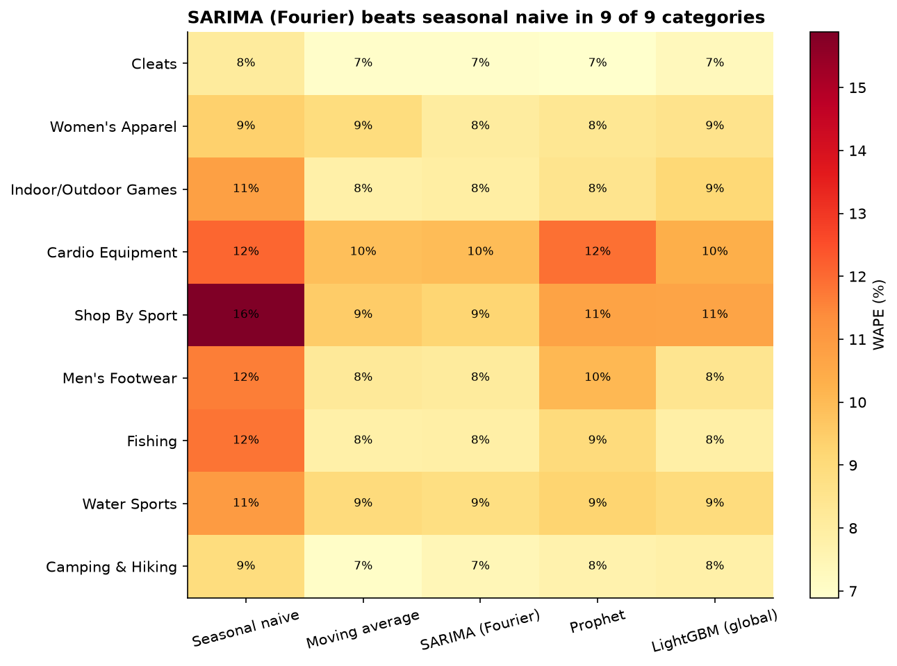
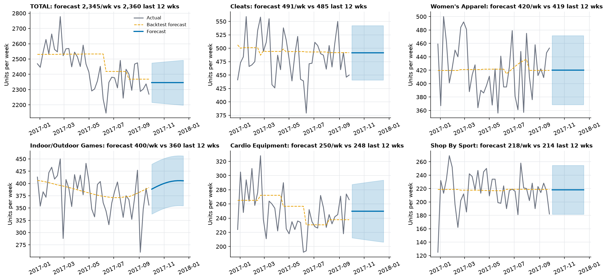

# Demand forecast results (Q1)

Generated by `python -m sca forecast`. Every number comes from this run.

- Run: 0.5 min on Windows / Python 3.11.9; seed 42; models: Seasonal naive, Moving average, SARIMA (Fourier), Prophet, LightGBM (global)

## Data and series selection

- Target: weekly units sold per category (valid orders; weeks start Monday), 143 weeks from 2015-01-05 to 2017-09-25.
- Forecasting cutoff: **2017-10-01**. Later weeks are excluded because order volume collapses (see `reports/data_profile.md`). Missing weeks are filled with 0.
- **9 categories** selected (configured maximum 10), plus TOTAL. Rule: rank by units, require at least 100 weeks and at most 5% zero weeks, stop at the first category that fails.

| category | units | weeks | zero_week_share | decision |
|---|---|---|---|---|
| Cleats | 70,283 | 143 | 0.0% | selected |
| Women's Apparel | 59,984 | 143 | 0.0% | selected |
| Indoor/Outdoor Games | 55,094 | 143 | 0.0% | selected |
| Cardio Equipment | 35,753 | 143 | 0.0% | selected |
| Shop By Sport | 31,180 | 143 | 0.0% | selected |
| Men's Footwear | 21,180 | 143 | 0.0% | selected |
| Fishing | 16,530 | 143 | 0.0% | selected |
| Water Sports | 14,817 | 143 | 0.0% | selected |
| Camping & Hiking | 13,091 | 143 | 0.0% | selected |
| Electronics (Outdoors) | 5,805 | 143 | 16.1% | 16% zero weeks > 5% |
| Accessories | 5,106 | 143 | 16.1% | 16% zero weeks > 5% |
| Golf Balls | 4,142 | 143 | 16.1% | 16% zero weeks > 5% |
| Girls' Apparel | 3,402 | 143 | 16.1% | 16% zero weeks > 5% |

## Models

| Model | Description |
|---|---|
| Seasonal naive | Same week last year (52 weeks back). The baseline to beat. |
| Moving average | Mean of the last 8 weeks, flat. |
| SARIMA (Fourier) | SARIMAX with ARIMA orders from a small grid and Fourier terms for yearly seasonality, chosen by AIC (orders [[0, 0, 0], [1, 0, 0], [1, 0, 1], [0, 1, 1], [1, 1, 1], [2, 1, 0]], K in [0, 2]). A literal seasonal period of 52 is not estimable from about 2.5 years of weekly data. |
| Prophet | Yearly seasonality, no weekly/daily terms; native intervals. |
| LightGBM (global) | One model for all series, horizon as a feature (direct multi-step), lag, rolling and calendar features computed at the forecast origin from past values only, series scaled by their trailing 52-week mean. Direct was chosen over recursive to avoid compounding errors and to avoid feeding predictions back as features. |

## Validation

Rolling-origin backtest with an expanding training window: **5 folds x 8-week horizon** (the last 40 weeks are test data, in contiguous non-overlapping windows). No random splits. Metrics are pooled over all test weeks and categories (volume-weighted); WAPE is the primary metric.

| Model | WAPE | MAPE | MAE (units/wk) | Bias | WAPE improvement vs seasonal naive |
|---|---|---|---|---|---|
| Seasonal naive | 10.6% | 11.3% | 26.1 | -0.0% | +0.0% |
| Moving average | 8.3% | 8.6% | 20.4 | +0.5% | +21.9% |
| SARIMA (Fourier) | 8.1% | 8.5% | 20.0 | +0.9% | +23.4% |
| Prophet | 8.8% | 9.3% | 21.7 | +0.6% | +16.6% |
| LightGBM (global) | 8.7% | 9.0% | 21.5 | +0.3% | +17.7% |

- TOTAL series: SARIMA (Fourier) WAPE 3.7% vs seasonal naive 5.9%.
- MAPE is reported but unreliable where weekly actuals get small or hit zero: flagged for no selected category. Prefer WAPE.

## Per category

| Category | Avg units/wk | WAPE SARIMA (Fourier) | WAPE seasonal naive | MAPE | MAPE unstable? | Bias |
|---|---|---|---|---|---|---|
| Cleats | 491 | 7.0% | 8.1% | 7.2% | no | +2.3% |
| Women's Apparel | 419 | 8.0% | 9.4% | 8.1% | no | +0.2% |
| Indoor/Outdoor Games | 385 | 7.9% | 10.8% | 8.5% | no | +2.0% |
| Cardio Equipment | 250 | 10.0% | 12.1% | 10.2% | no | +1.5% |
| Shop By Sport | 218 | 9.2% | 15.9% | 10.1% | no | +1.0% |
| Men's Footwear | 148 | 8.1% | 11.6% | 8.2% | no | -0.3% |
| Fishing | 116 | 7.9% | 11.8% | 7.8% | no | -1.3% |
| Water Sports | 104 | 8.8% | 11.0% | 9.1% | no | -2.5% |
| Camping & Hiking | 92 | 7.4% | 8.9% | 7.3% | no | -2.1% |

### Prediction interval coverage (native intervals, backtest)

| Model | Share of actuals inside the interval | Nominal |
|---|---:|---:|
| Prophet | 68.0% | 80% |
| SARIMA (Fourier) | 79.2% | 80% |

## Champion

**SARIMA (Fourier).** SARIMA (Fourier) has the lowest pooled backtest WAPE (8.1%), 23.4% better than seasonal naive (10.6%). It beats the simple moving average by only 0.2 percentage points, which is within backtest noise: a flat 8-week average is almost as good here. The champion is chosen once, for all categories, from pooled backtest WAPE. Choosing per category would pick the best of 5 models on only 40 test weeks each, which overstates accuracy.

## 12-week forecast

The champion was refit on all history up to the cutoff. Intervals (80%) are native model intervals.

TOTAL: 28,142 units over 12 weeks (2,345 per week; last 12 actual weeks averaged 2,360).

## Caveats

- The backtest has 40 test weeks per series; differences of a few WAPE points between models are within noise.
- Weekly seasonality is weak in this dataset (see `reports/eda_findings.md`), which limits how far any model can beat a seasonal-naive baseline.
- The dataset looks synthetic and the post-cutoff regime change is unexplained, so the forecast assumes the pre-cutoff regime continues.
- Outputs: `fct_forecast` (history, champion backtest and forecast with intervals) and the backtest residuals under `data/processed/forecast/` (used by the Phase 5 simulation).
