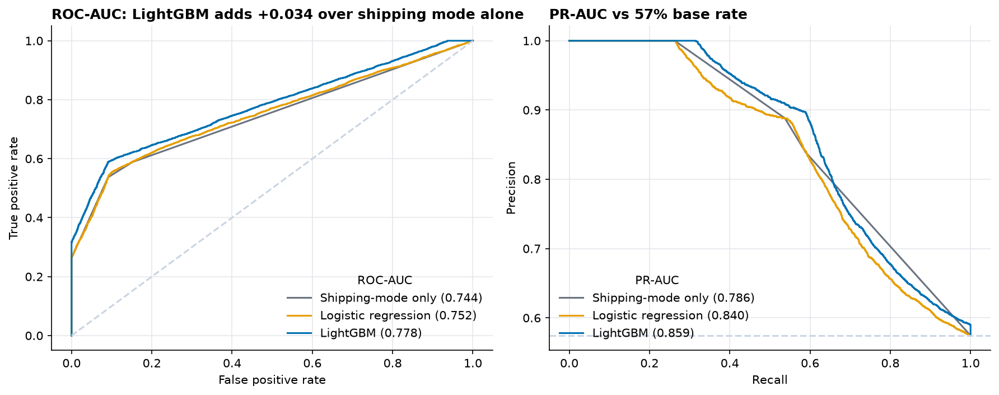
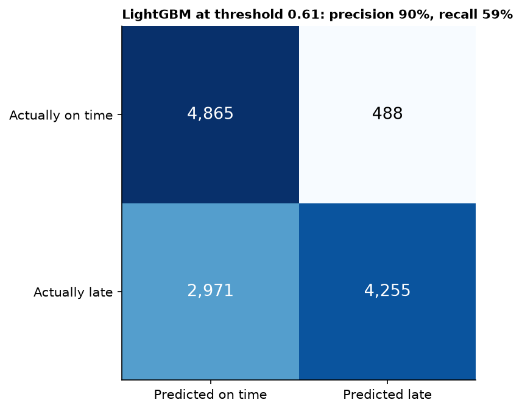
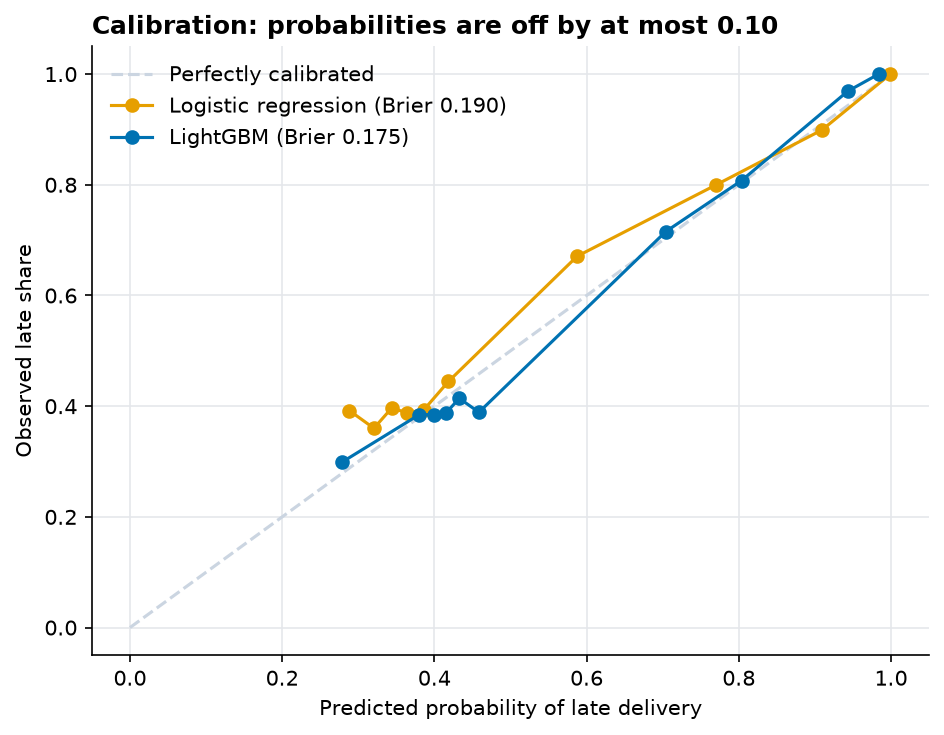
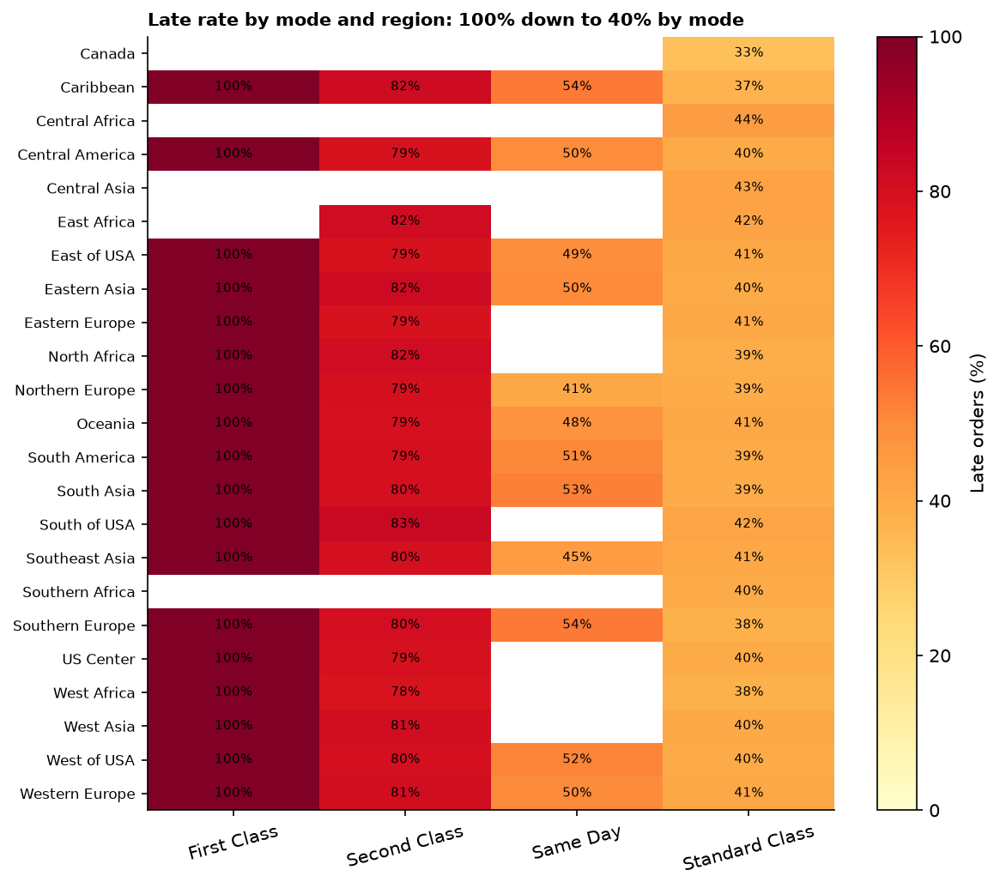
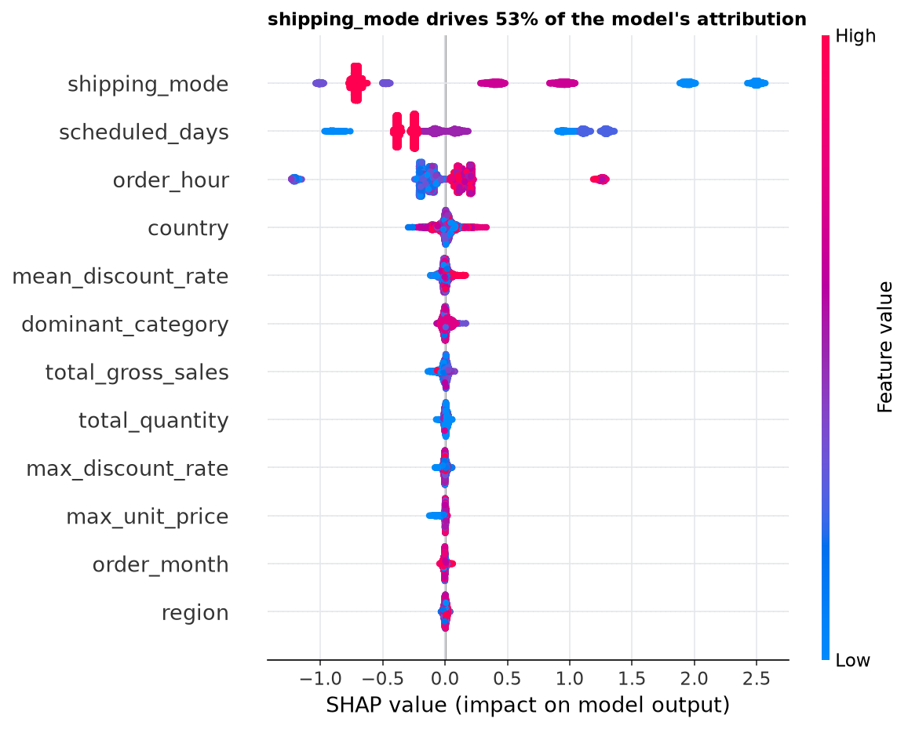
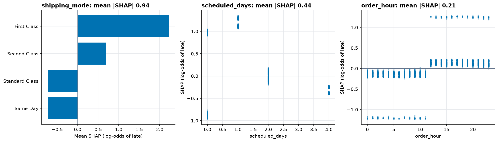

# Late-delivery risk model results (Q2)

Generated by `python -m sca risk`. Every number comes from this run.

## Setup

- Unit: **order** (items of an order share one ship date and label). 62,897 valid orders; cancelled and suspected-fraud orders are excluded because they never shipped.
- Target: late delivery (actual shipping days > scheduled). Base rate 57.3%.
- **Time-based split:** train 42,770 orders (2015-01-01 to 2017-02-21, 57.3% late), validation 7,548 (to 2017-07-10, 56.9%), test 12,579 (the most recent 20%, to 2018-01-31, 57.4%). No random splits. Validation (the latest part of the training period) is used for early stopping and the threshold only.
- Features (20), all known at order time: `shipping_mode`, `market`, `region`, `country`, `segment`, `payment_type`, `customer_country`, `dominant_category`, `dominant_department`, `scheduled_days`, `n_items`, `total_quantity`, `total_gross_sales`, `max_discount_rate`, `mean_discount_rate`, `max_unit_price`, `n_categories`, `order_dow`, `order_hour`, `order_month`.
- Categorical levels seen fewer than 50 times in training are grouped as `OTHER` (fit on training data only).

## Leakage review

Excluded because they are only known after shipping or delivery (or are derived from outcomes): `cost_amount`, `delivery_status`, `is_late`, `late_delivery_risk`, `order_status`, `profit`, `profit_per_unit`, `profit_ratio`, `ship_date`, `ship_date_key`, `ship_ts`, `shipping_days_real`, `shipping_delay_days`. `tests/test_risk_model.py` asserts none of them can reach the feature matrix.
- Best test ROC-AUC is 0.778; the alarm level is 0.95. It is well below the alarm level, so there is no sign of leakage.

## Test performance

| Model | ROC-AUC | PR-AUC | Brier | Threshold | Precision | Recall |
|---|---|---|---|---|---|---|
| Shipping-mode only | 0.744 | 0.786 | 0.188 | 0.46 | 83.9% | 58.9% |
| Logistic regression | 0.752 | 0.840 | 0.190 | 0.48 | 88.0% | 55.5% |
| LightGBM | 0.778 | 0.859 | 0.175 | 0.61 | 89.7% | 58.9% |

Thresholds are chosen on the validation set. Cost assumption: a missed late order costs 1 and an unnecessary intervention costs 1 (relative units). Champion by validation PR-AUC: **LightGBM**.

Confusion matrix on the test set (LightGBM): 4,255 late orders caught, 2,971 missed, 488 false alarms, 4,865 correctly cleared.

### Threshold sensitivity

The right threshold depends on how much worse a miss is than a false alarm. With a high base rate (57% late), a larger miss cost makes the optimal rule flag almost every order.

| Miss : false-alarm cost | Threshold | Orders flagged | Precision | Recall |
|---|---|---|---|---|
| 1 : 1 | 0.61 | 38% | 89.7% | 58.9% |
| 2 : 1 | 0.32 | 97% | 59.1% | 99.7% |
| 5 : 1 | 0.32 | 97% | 59.1% | 99.7% |

### Ranking the riskiest orders

| Riskiest share of orders | Orders | Late rate | Lift vs base rate |
|---|---|---|---|
| 10% | 1,257 | 100.0% | 1.74x |
| 25% | 3,144 | 94.8% | 1.65x |
| 50% | 6,289 | 77.5% | 1.35x |
| 75% | 9,434 | 64.9% | 1.13x |

## What drives lateness

**Shipping mode alone gets ROC-AUC 0.744; the best model gets 0.778.** Shipping mode therefore accounts for about 88% of the model's lift over chance. Lateness is mostly decided by the shipping mode and its scheduled-days promise, not by who orders or what is ordered.

| Shipping mode | Orders | Late % | Scheduled days |
|---|---|---|---|
| First Class | 9,602 | 100.0% | 1 |
| Second Class | 12,256 | 80.0% | 2 |
| Same Day | 3,407 | 48.4% | 0 |
| Standard Class | 37,632 | 39.8% | 4 |

Within a shipping mode, regions move the late rate by at most 13 pp (cells with at least 100 orders).

### Order-time cut-off

**Same Day orders placed before 12:00 are 0% late (1,759 orders); placed from 12:00 on, 100% late (1,648 orders).** Order hour is known at order time, so this is a legitimate feature, and it is why `order_hour` ranks high in the SHAP table. In practice it looks like a noon cut-off that the same-day promise ignores.

### SHAP (LightGBM, test sample of 5,000 orders)

| Feature | Mean abs SHAP | Share of attribution |
|---|---|---|
| shipping_mode | 0.937 | 53.3% |
| scheduled_days | 0.439 | 24.9% |
| order_hour | 0.206 | 11.7% |
| country | 0.045 | 2.6% |
| mean_discount_rate | 0.020 | 1.1% |

## Caveats

- In the SHAP summary, colour for categorical features (shipping mode, country, ...) is the level's integer code, not an ordering; read those rows for spread, not colour.
- The dataset looks synthetic, so relationships that look like business insight may be generator artefacts.
- Scores for train and validation orders in `fct_late_risk_scores` are in-sample; use the `split` column to show only test scores.
- The most recent orders come from the post-October-2017 low-volume regime (see `reports/data_profile.md`); the test period includes it.
- Outputs: `fct_late_risk_scores` and `fct_shap_drivers` (database), parquet copies under `data/processed/risk/`.
