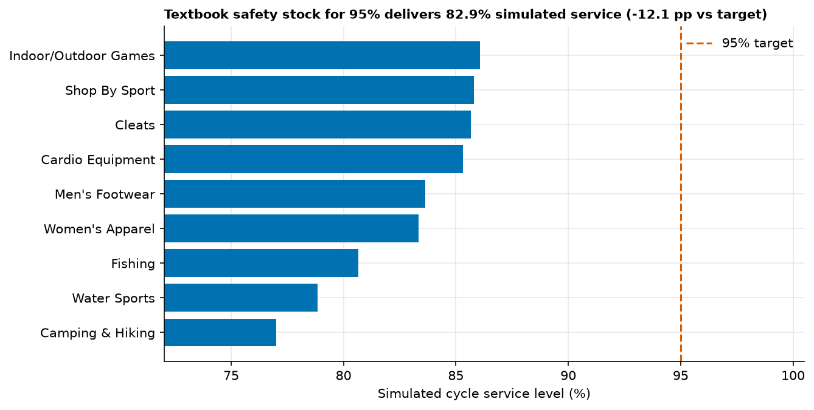
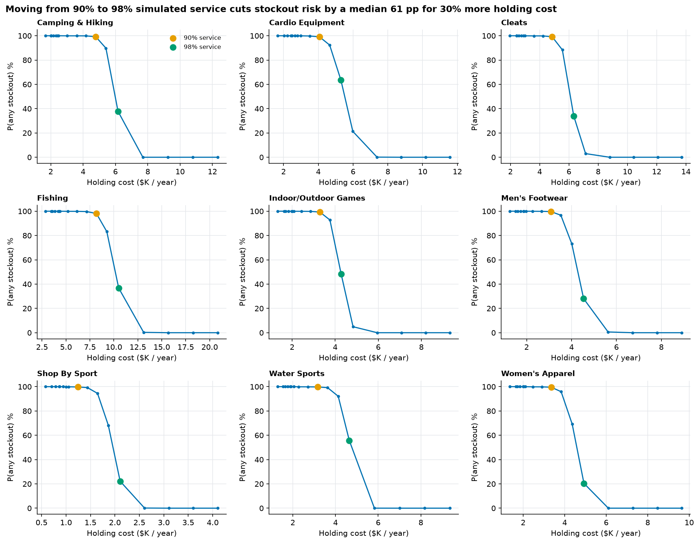

# Inventory simulation results (Q3)

Generated by `python -m sca simulate`. Every number comes from this run.

> **The dataset has no inventory data.** This simulates an inventory policy on top of the Phase 3 demand forecast. The supplier lead times, holding cost and unit cost below are **assumptions** (in `config.yaml`), not facts about DataCo.

## Assumptions

| Assumption | Value |
|---|---|
| Policy | Periodic review, order-up-to (R, S); S = mean demand x (R + mean lead time) + safety stock |
| Review period R | 1 week(s) |
| Supplier lead time | 1 wk (30%), 2 wk (50%), 3 wk (20%); mean 1.9 weeks (not the customer shipping days) |
| Unit cost | 60% of the category's average list price |
| Holding cost | 0.50% of unit cost per unit-week (26% a year) |
| Target service levels (analytic baseline) | 90%, 95%, 98%, 99% |
| Simulations | 10,000 paths of 52 weeks per safety-stock level, seed 42 |
| Unmet demand | Lost (no backorders): a lost sale is never replenished, which makes service slightly better than a backorder model at low stock |

## Method

- Demand per week = the sarima forecast level for that week plus a residual bootstrapped from the champion's backtest residuals (actual minus forecast, 40 per category), floored at zero and rounded to units. After the 12 forecast weeks the level is held at the forecast mean.
- Analytic baseline: safety stock = z x sigma x sqrt(R + L) with sigma the standard deviation of the backtest residuals and L the mean lead time (1.9 weeks).
- All safety-stock levels of a category share the same demand and lead-time draws, so differences between levels are not simulation noise.
- Metrics: probability of at least one stockout in the year, cycle service level (share of weeks with no stockout), fill rate (share of demand met), average inventory and annual holding cost.

## Analytic baseline vs simulation

| Category | Mean demand / wk | Forecast-error sd | SS @90% | Simulated @90% | SS @95% | Simulated @95% | SS @98% | Simulated @98% | SS @99% | Simulated @99% |
|---|---|---|---|---|---|---|---|---|---|---|
| Camping & Hiking | 92 | 7.9 | 17 | 72.4% | 22 | 77.0% | 28 | 82.0% | 31 | 84.0% |
| Cardio Equipment | 250 | 30.2 | 66 | 82.6% | 85 | 85.3% | 106 | 87.4% | 120 | 88.2% |
| Cleats | 491 | 40.2 | 88 | 83.1% | 113 | 85.7% | 140 | 87.4% | 159 | 88.1% |
| Fishing | 116 | 11.1 | 24 | 76.5% | 31 | 80.7% | 39 | 84.2% | 44 | 85.8% |
| Indoor/Outdoor Games | 400 | 39.2 | 85 | 82.8% | 110 | 86.1% | 137 | 88.0% | 155 | 88.6% |
| Men's Footwear | 149 | 15.7 | 34 | 79.8% | 44 | 83.6% | 55 | 86.2% | 62 | 87.2% |
| Shop By Sport | 218 | 27.4 | 60 | 82.6% | 77 | 85.8% | 96 | 87.9% | 109 | 88.7% |
| Water Sports | 104 | 11.5 | 25 | 73.8% | 32 | 78.8% | 40 | 83.7% | 46 | 86.3% |
| Women's Apparel | 420 | 41.1 | 90 | 79.8% | 115 | 83.3% | 144 | 86.1% | 163 | 87.4% |

The textbook formula assumes a fixed lead time. With supplier lead times of 1 to 3 weeks (sd 0.70), the simulated cycle service level at the 95% setting averages **82.9%** across categories, below the 95% target. Lead-time variability makes up 94% of the variance of demand over the protection interval, which the formula ignores.

Stock needed to actually reach a simulated 95% cycle service level, versus the textbook figure:

| Category | Textbook SS | Simulated SS needed | Multiple of textbook |
|---|---|---|---|
| Camping & Hiking | 22 | 115 | 5.2x |
| Cardio Equipment | 85 | 273 | 3.2x |
| Cleats | 113 | 526 | 4.7x |
| Fishing | 31 | 145 | 4.7x |
| Indoor/Outdoor Games | 110 | 432 | 3.9x |
| Men's Footwear | 44 | 189 | 4.3x |
| Shop By Sport | 77 | 279 | 3.6x |
| Water Sports | 32 | 132 | 4.1x |
| Women's Apparel | 115 | 529 | 4.6x |

## Trade-off and recommendations

For each category, the comparison is the cheapest safety stock that reaches a simulated cycle service level of 90% versus the cheapest that reaches 98%.

- Camping & Hiking: raising safety stock from 99 to 132 units cuts stockout risk (at least one stockout in 52 weeks) from 99% to 38% for 29% more holding cost.
- Cardio Equipment: raising safety stock from 228 to 319 units cuts stockout risk (at least one stockout in 52 weeks) from 99% to 64% for 30% more holding cost.
- Cleats: raising safety stock from 438 to 614 units cuts stockout risk (at least one stockout in 52 weeks) from 99% to 34% for 30% more holding cost.
- Fishing: raising safety stock from 125 to 166 units cuts stockout risk (at least one stockout in 52 weeks) from 98% to 37% for 28% more holding cost.
- Indoor/Outdoor Games: raising safety stock from 360 to 504 units cuts stockout risk (at least one stockout in 52 weeks) from 99% to 48% for 30% more holding cost.
- Men's Footwear: raising safety stock from 135 to 216 units cuts stockout risk (at least one stockout in 52 weeks) from 100% to 28% for 47% more holding cost.
- Shop By Sport: raising safety stock from 160 to 319 units cuts stockout risk (at least one stockout in 52 weeks) from 100% to 22% for 70% more holding cost.
- Water Sports: raising safety stock from 94 to 150 units cuts stockout risk (at least one stockout in 52 weeks) from 100% to 56% for 47% more holding cost.
- Women's Apparel: raising safety stock from 378 to 604 units cuts stockout risk (at least one stockout in 52 weeks) from 100% to 20% for 47% more holding cost.

| Category | From (units) | To (units) | Stockout risk before | Stockout risk after | Holding cost increase |
|---|---|---|---|---|---|
| Camping & Hiking | 99 | 132 | 99% | 38% | +29% |
| Cardio Equipment | 228 | 319 | 99% | 64% | +30% |
| Cleats | 438 | 614 | 99% | 34% | +30% |
| Fishing | 125 | 166 | 98% | 37% | +28% |
| Indoor/Outdoor Games | 360 | 504 | 99% | 48% | +30% |
| Men's Footwear | 135 | 216 | 100% | 28% | +47% |
| Shop By Sport | 160 | 319 | 100% | 22% | +70% |
| Water Sports | 94 | 150 | 100% | 56% | +47% |
| Women's Apparel | 378 | 604 | 100% | 20% | +47% |

Across the 9 categories the annual holding cost goes from $36,011 to $48,792 (+35%) under these assumptions.

## Caveats

- Stockout risk over a full year is a demanding measure: even a 98% weekly service level leaves a high chance of at least one stockout in 52 weeks. Use cycle service level and fill rate for day-to-day targets.
- Residuals are bootstrapped from only 40 backtest weeks per category, and the forecast beyond 12 weeks is a flat level. Demand is assumed independent across weeks.
- Lead-time distribution, holding cost and unit cost are assumptions; changing them changes every number here.
- Outputs: `fct_simulation_results` and `fct_simulation_recommendations` (database), parquet copies under `data/processed/simulation/`.
